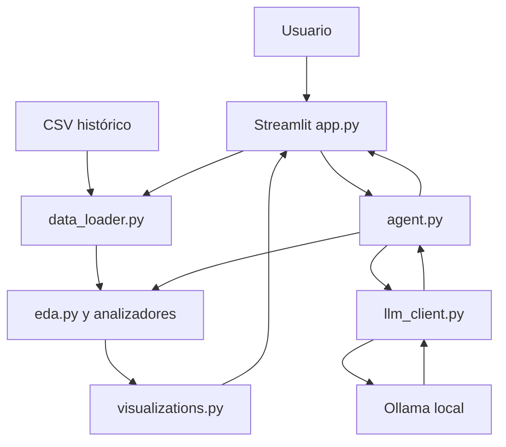

# Análisis de incidentes TI con un agente local

Proyecto final de Kevin Alexis Barrera Llerena, Universidad Casa Grande, C2026P1.
Aplicación local en Python y Streamlit con un agente que consulta cálculos autorizados y solicita explicaciones a Ollama.

## Qué problema resuelve

Permite examinar prioridades, calidad y duración registrada de incidentes históricos. La unidad analítica es un incidente único, obtenido a partir de su última actualización. El modelo explica resultados previamente calculados; las estadísticas se obtienen con pandas.

La relación profesional es la gestión de incidentes en SRE. Los datos son públicos de otra organización: no describen a TEUNO ni al ISSPOL. No contienen logs de aplicaciones, métricas de CPU ni evidencia de despliegues. La investigación de causas y la automatización de remediaciones quedan fuera de esta implementación.

## Empieza por aquí

Lee `docs/01_PLAN_Y_DECISIONES.md` y después `docs/02_GUIA_POR_FASES.md`.

Antes de instalar, abre PowerShell en VS Code y ejecuta:

```powershell
py --version
ollama --version
git --version
```

Que un comando no exista solamente indica que falta instalarlo o incorporarlo a PATH. El diagnóstico ampliado está en `scripts/diagnostico_windows.ps1`; es de solo lectura. Si Windows bloquea scripts, copia sus instrucciones a la terminal por partes, sin cambiar políticas del equipo.

## Requisitos

- Windows 11 de 64 bits. Equipo objetivo: Core i9 de 13.ª generación y 16 GB de RAM.
- Python 3.13 x64 para una instalación nueva. Python 3.12 x64 es una alternativa compatible si ya está instalado. La validación inicial se realizó con Python 3.12.14 en Linux; Windows debe verificarse localmente.
- VS Code con las extensiones Python y Pylance de Microsoft.
- Ollama para Windows y el modelo `llama3.2:3b`. Alternativa si falta memoria o la respuesta es muy lenta: `llama3.2:1b`.
- Git para mantener el historial y publicar posteriormente el repositorio.
- Navegador y conexión a Internet para instalar y descargar el modelo. Con los paquetes, CSV y modelo disponibles, el flujo de la app usa recursos locales.
- Reservar aproximadamente 10–15 GB libres para instaladores, entorno y modelo es una recomendación práctica, no una medición de uso en este PC. Ollama documenta al menos 4 GB para sus binarios, más el espacio del modelo.

Fuentes de instalación:

- Python: https://www.python.org/downloads/windows/
- Extensiones Python: https://code.visualstudio.com/docs/python/python-tutorial
- Ollama: https://ollama.com/download/windows
- Git: https://git-scm.com/downloads/win

## Instalación en Windows paso a paso

Extrae el ZIP en una carpeta de trabajo, por ejemplo `C:\Proyectos\ProyectoFinal_Incidentes_Alexis_Barrera`, y abre esa carpeta desde VS Code. No ejecutes los comandos dentro del ZIP ni dentro de la carpeta superior equivocada. La carpeta abierta debe contener `app.py` y `requirements.txt`.

### 1 Crear un entorno aislado

```powershell
py -3.13 -m venv .venv
```

Si ya tienes Python 3.12, usa `py -3.12 -m venv .venv`. No es necesario instalar ambos.

En VS Code, `Ctrl+Shift+P` → `Python: Select Interpreter` → `.venv\Scripts\python.exe`.

Puedes activar el entorno con `.\.venv\Scripts\Activate.ps1`. Los siguientes comandos utilizan directamente el intérprete del entorno y funcionan sin activación, incluso si PowerShell bloquea ese script.

### 2 Instalar dependencias

```powershell
.\.venv\Scripts\python.exe -m pip install --upgrade pip
.\.venv\Scripts\python.exe -m pip install -r requirements.txt
.\.venv\Scripts\python.exe -m pip check
```

Las dependencias directas están fijadas en `requirements.txt`. Las dependencias transitivas las resuelve pip; después de validar el equipo, guarda un registro del entorno:

```powershell
New-Item -ItemType Directory -Force resultados_locales
.\.venv\Scripts\python.exe -m pip freeze | Out-File -Encoding utf8 resultados_locales\entorno_windows.txt
```

### 3 Validar los datos y las reglas

```powershell
.\.venv\Scripts\python.exe -m unittest discover -s tests -v
.\.venv\Scripts\python.exe -m scripts.validar_datos
```

Se esperan 119.998 eventos, 36 columnas originales, 20.769 incidentes y 1.418 incidentes sin duración. El resumen y las versiones del equipo se guardan en `resultados_locales/validacion_datos.json`.

Comprobación adicional reproducible de la UI, sin navegador ni inferencia:

```powershell
.\.venv\Scripts\python.exe -m scripts.validar_interfaz
```

### 4 Preparar Ollama

Instala Ollama desde el enlace oficial, ábrelo desde Inicio y abre una terminal nueva de VS Code para que reconozca el comando.

```powershell
ollama --version
ollama pull llama3.2:3b
ollama list
Invoke-RestMethod -Uri http://127.0.0.1:11434/api/tags
```

Si necesitas el modelo pequeño:

```powershell
ollama pull llama3.2:1b
```

Descargar un modelo no modifica Python. Ollama es un programa aparte que atiende en el puerto local 11434. La app permite elegir cuál de los dos modelos consultar. Si Ollama ya está funcionando en segundo plano no inicies otra instancia con `ollama serve`; ese comando solo sirve para arrancarlo manualmente cuando no hay servidor.

### 5 Ejecutar Streamlit

```powershell
.\.venv\Scripts\python.exe -m streamlit run app.py
```

Abre http://127.0.0.1:8501. Para detener: `Ctrl+C` en la terminal. En siguientes sesiones puedes usar `iniciar.bat` después de completar la instalación.

### macOS o Linux

```bash
python3 -m venv .venv
source .venv/bin/activate
python -m pip install -r requirements.txt
python -m unittest discover -s tests -v
python -m streamlit run app.py
```

Instala Ollama siguiendo su documentación para tu sistema y descarga el mismo modelo.

## Uso y ejemplos

1. Abre Resumen con el CSV incluido. Observa que eventos e incidentes son cifras distintas.
2. Selecciona solamente `1 - Critical`. Deben aparecer 220 incidentes y una mediana de 78,17 horas.
3. En Explorar cambia entre `reassignment_count` y `priority`: se utiliza el mismo contrato, con estadísticas o frecuencias según el tipo.
4. En Agente local pulsa Verificar Ollama. Selecciona Comparar prioridades y pregunta: «¿Qué diferencias observas entre prioridades y qué limitaciones tienen estas comparaciones?».
5. Contrasta la respuesta con el JSON de evidencia. Descarga la consulta para documentar la revisión.

El modelo puede equivocarse aunque reciba evidencia. No se declara una validación automática de sus afirmaciones. Si el servicio falla, se muestra el error y el análisis sigue disponible; no se simula una respuesta de IA.

## Arquitectura



`src/data_loader.py` carga y consolida; `src/eda.py` contiene funciones, Strategy, Factory y Facade; `src/visualizations.py` produce Plotly; `src/agent.py` coordina una lista cerrada de herramientas; `src/llm_client.py` realiza HTTP local. `app.py` contiene componentes y estado de la interfaz.

El patrón Strategy cambia el analizador numérico o categórico, Factory decide cuál crear y Facade ofrece las operaciones del caso a la interfaz y al agente. No se necesita un framework de agentes para este alcance.

## Datos y licencia

El CSV exacto de los talleres anteriores se incluye en `data/`. Consulta `data/README.md` para la atribución, licencia, hash y diferencias con el conjunto original de UCI.

## Validación y límites

- La suite verifica la consolidación, nulos, orden día/mes, filtros, Strategy/Factory, contrato del agente y fallos de conexión. Sus dobles de prueba no son evidencia de inferencia real.
- La UI se comprobó con Streamlit AppTest en Linux. No sustituye la ejecución en Windows ni la revisión visual del navegador del estudiante.
- La conexión real con el modelo, su digest, latencia y calidad de respuesta deben registrarse en el equipo del estudiante.
- Los contadores finales y las horas se usan para descripción retrospectiva. No hay modelo predictivo ni evaluación de causa raíz.
- Un registro tiene resolución posterior a la última actualización. Se conserva y se informa como anomalía del dato histórico.
- Las fechas no incluyen zona horaria: la duración es una diferencia entre marcas del mismo archivo, sin inferir zona ni horario laboral.

## Repositorio y entrega académica

La guía actual exige un PDF de máximo 15 páginas en APA 7, Anexo A con capturas reales, Anexo B con GitHub accesible y Anexo C con YouTube público o no listado, máximo cinco minutos. El despliegue obligatorio es local.

Tras comprender y verificar el proyecto, crea un repositorio en GitHub desde tu cuenta y sigue el procedimiento de `docs/02_GUIA_POR_FASES.md`. No subas `.venv`, modelos ni resultados locales. La publicación queda pendiente; no hay una URL de repositorio o video inventada en este paquete.

Commit sugerido después de validar:

```text
feat: integrar análisis modular de incidentes y agente local con Ollama
```

Para revertir una prueba local, detén Streamlit. Si necesitas reconstruir dependencias, elimina únicamente la carpeta `.venv` de este proyecto y vuelve a crearla. Conserva el CSV original y el código versionado.
