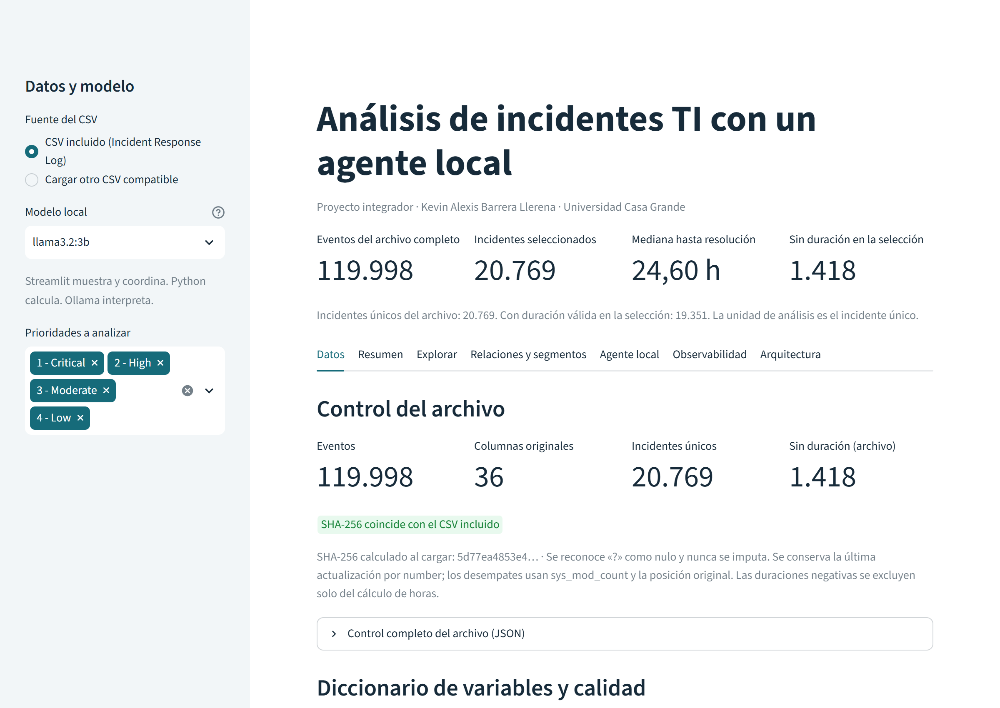
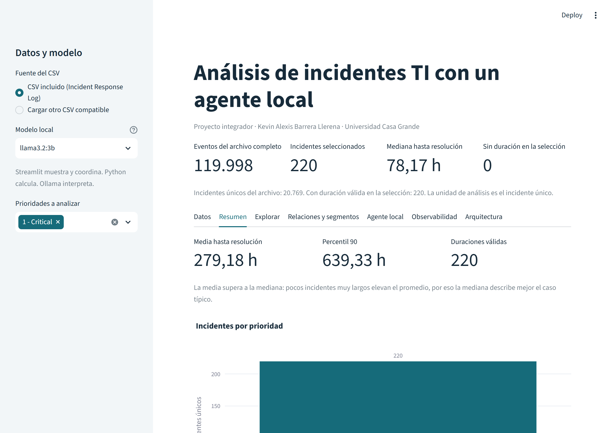
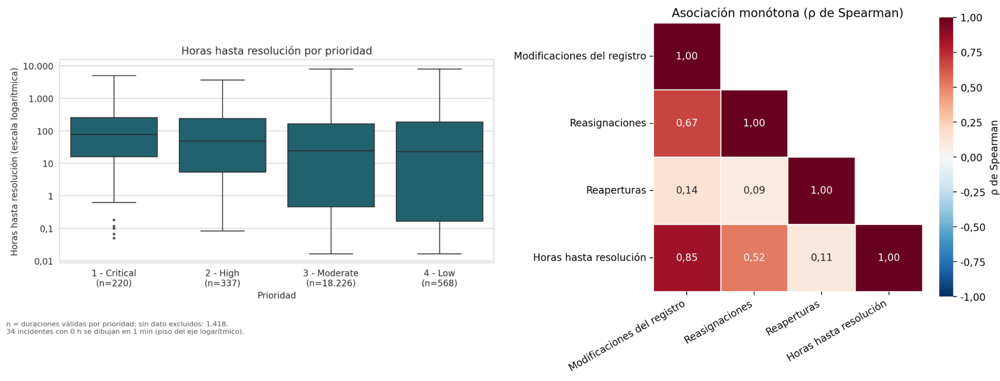
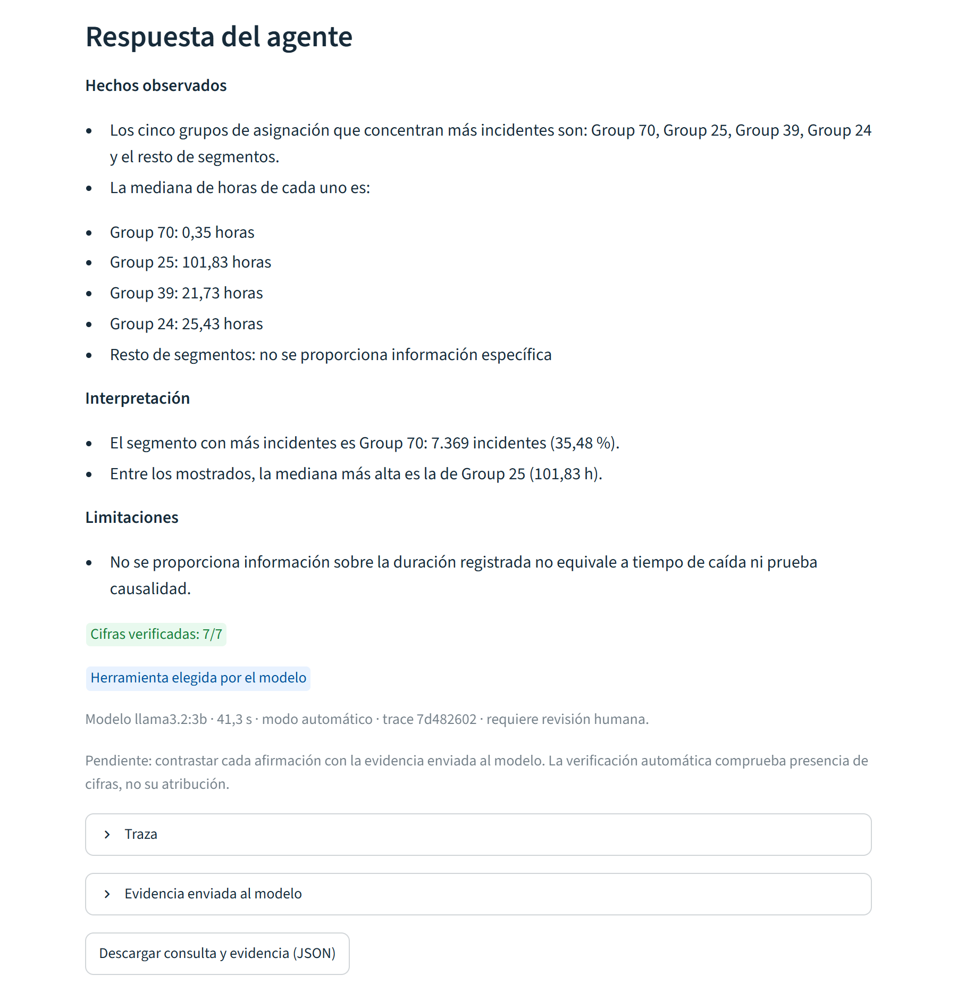
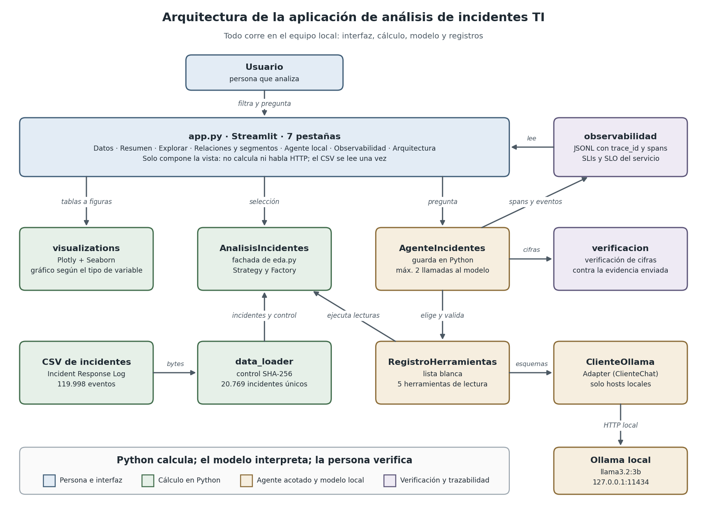

Proyecto Final Integrador de *Paradigmas de Programación para Inteligencia Artificial y Análisis de Datos*, Maestría en Inteligencia Artificial y Ciencia de Datos, Universidad Casa Grande, C2026 P1. Autor: Kevin Alexis Barrera Llerena.

- Código fuente y guía de instalación: [repositorio en GitHub](https://github.com/Alexis-VsCode/ProyectoFinal-Incidentes-Ollama-C2026P1)
- Estado de las pruebas automáticas: [GitHub Actions](https://github.com/Alexis-VsCode/ProyectoFinal-Incidentes-Ollama-C2026P1/actions/workflows/pruebas.yml)

La aplicación se ejecuta en el equipo del usuario, porque el agente usa un modelo local con Ollama. Esta página resume el proyecto; no ejecuta la aplicación.

## Qué hace

Analiza el registro público Incident Response Log (Kaggle, versión 2): 119.998 eventos que corresponden a 20.769 incidentes. Python consolida cada incidente en su última actualización, calcula la duración entre apertura y resolución, perfila la calidad de los datos, segmenta por prioridad, categoría y grupo, y mide relaciones con Pearson y Spearman. Los gráficos usan Plotly y Seaborn según el tipo de variable.

Un agente con `llama3.2:3b` responde preguntas sobre esos resultados. El modelo elige una herramienta de una lista cerrada de cinco, todas de solo lectura. Python valida la elección y calcula, y el modelo redacta la interpretación. La aplicación comprueba que cada cifra de la respuesta exista en lo calculado.



## Resultados destacados

| Indicador | Valor |
|---|---|
| Incidentes únicos | 20.769 |
| Duraciones válidas | 19.351 (1.418 sin dato, sin imputar) |
| Mediana hasta resolución | 24,6 h (media 187,68 h: cola larga) |
| Mediana de prioridad Critical | 78,17 h en 220 incidentes |
| Spearman reasignaciones y horas | 0,52 (asociación, no causa) |

Las horas describen el histórico de otra organización. No son SLO, SLA ni MTTR.





## El agente en una consulta real

Pregunta: «¿Qué cinco grupos de asignación concentran más incidentes y cuál es la mediana de horas de cada uno?». El modelo eligió la herramienta `segmentar` con el grupo de asignación y cinco segmentos; la respuesta cita 7 cifras y las 7 están en la evidencia calculada.



## Arquitectura



| Pieza | Dónde | Problema que resuelve |
|---|---|---|
| Strategy | `AnalizadorVariable`, `AnalizadorNumerico`, `AnalizadorCategorico` | Resumir distinto una variable numérica y una categórica sin condicionales en la interfaz |
| Factory | `AnalizadorFactory.crear` | Decidir en un solo lugar qué estrategia corresponde a cada tipo de dato |
| Facade | `AnalisisIncidentes` | Dar a la interfaz y al agente una sola entrada al análisis |
| Adapter | `ClienteOllama` | Aislar la comunicación con Ollama y permitir pruebas sin el servicio |
| Registro | `RegistroHerramientas` | Lista blanca única de lo que el modelo puede pedir |

Más detalle en [decisiones de diseño](DECISIONES.md), [observabilidad](OBSERVABILIDAD.md) y [solución de problemas](RUNBOOK.md).

## Cómo ejecutarlo

Requisitos: Windows 11 o Linux, Python 3.13, Ollama y el modelo `llama3.2:3b`.

```powershell
git clone https://github.com/Alexis-VsCode/ProyectoFinal-Incidentes-Ollama-C2026P1.git
cd ProyectoFinal-Incidentes-Ollama-C2026P1
py -3.13 -m venv .venv
.\.venv\Scripts\python.exe -m pip install -r requirements.txt
ollama pull llama3.2:3b
.\.venv\Scripts\python.exe -m streamlit run app.py
```

La aplicación abre en `http://127.0.0.1:8501`. Las instrucciones completas están en el [README](https://github.com/Alexis-VsCode/ProyectoFinal-Incidentes-Ollama-C2026P1#readme).
